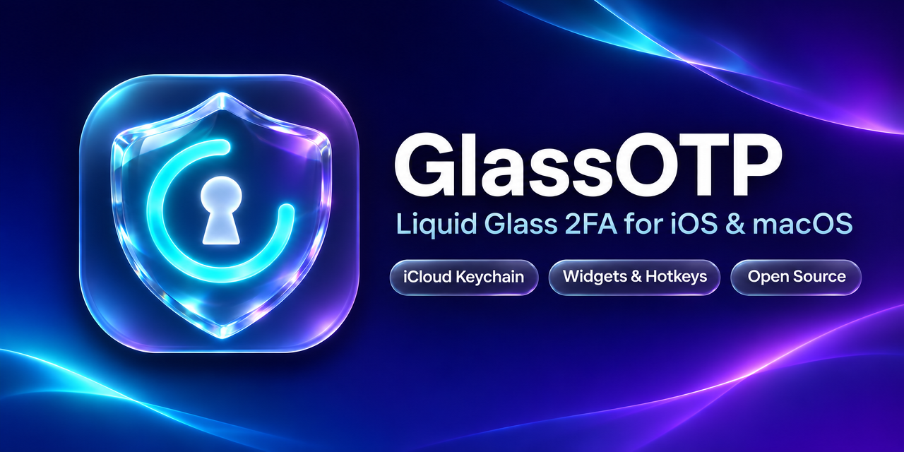
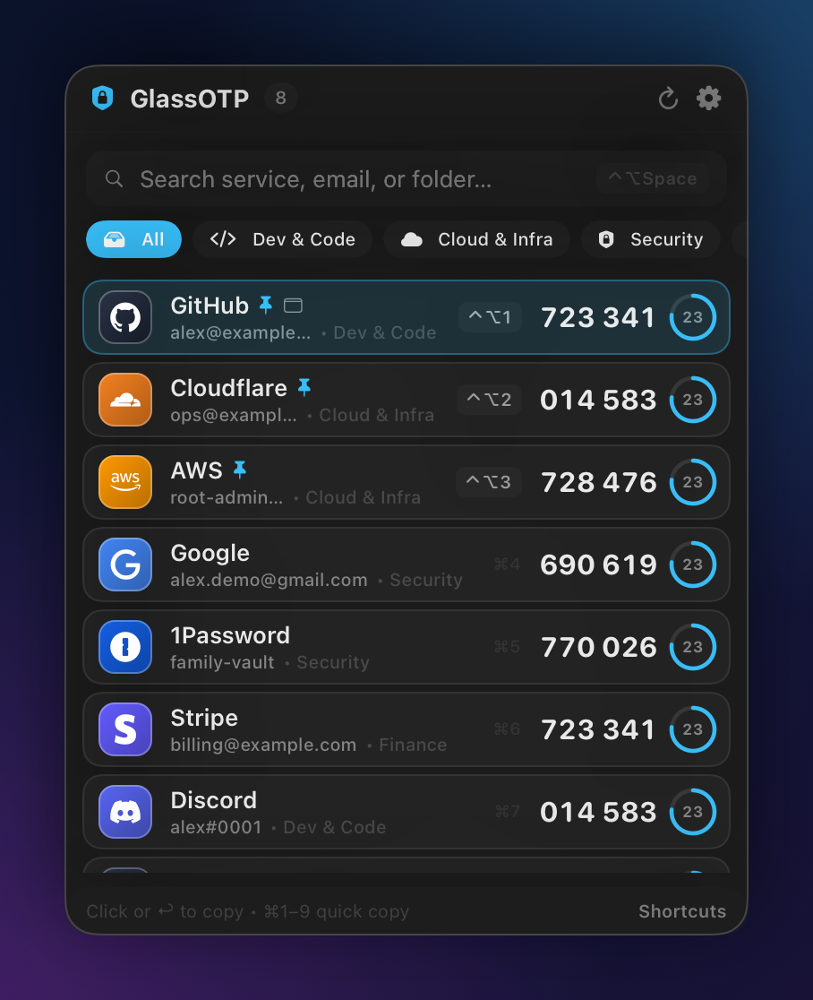
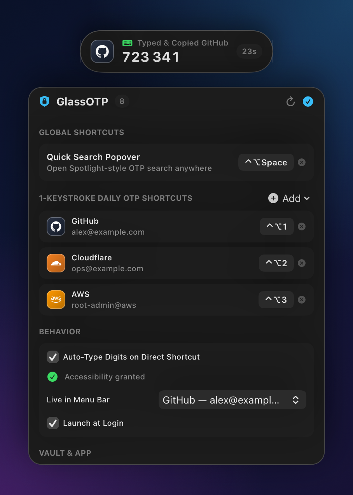
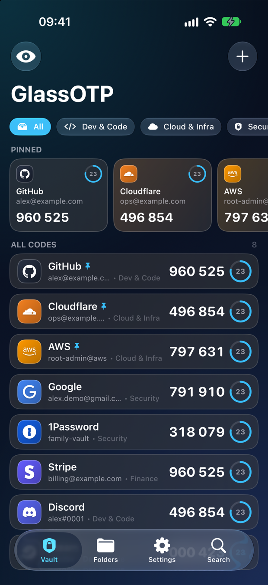
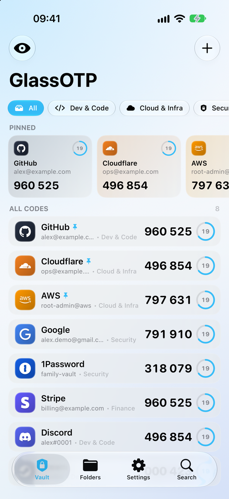

# GlassOTP



GlassOTP is an open-source, native iOS 26+ and macOS 26+ two-factor authenticator (TOTP/HOTP) with Liquid Glass UI, 1-keystroke global macOS auto-type, interactive Home and Lock Screen widgets, iCloud Keychain sync, and on-device multi-provider backup import.

## 1-Keystroke Auto-Type on macOS

Bind your daily OTP accounts to direct global shortcuts (`⌃⌥1`–`⌃⌥9` or any custom shortcut) and enable **Auto-Type Digits on Direct Shortcut** (with macOS Accessibility permission) so 2FA prompts take a single keystroke from any browser, terminal, or VPN client:

1. Press your account's global shortcut without leaving the focused login input.
2. GlassOTP reserves/computes the live code, waits for modifier keys to release, verifies that the captured frontmost app (`postToPid`) is still active, and enters the OTP digits directly into the field while copying the code to a 60-second auto-clearing clipboard (`ConcealedType` / `TransientType`).
3. A floating **`Typed & Copied`** confirmation HUD confirms delivery with zero window switching, phone unlocking, or `⌘V`.

Press `⌃⌥Space` anytime to open the floating Spotlight-style vault popover and copy any account with `Return` or `⌘1`–`⌘9`.

## Screenshots

### macOS Menu Bar & 1-Keystroke Auto-Type

| Quick Search & Direct Shortcut Badges (`⌃⌥1`–`⌃⌥3`) | 1-Keystroke Shortcuts, Auto-Type & `Typed & Copied` HUD |
|---|---|
|  |  |

### iOS Liquid Glass Vault (Dark & Light)

| Dark Mode | Light Mode |
|---|---|
|  |  |

## Quickstart

**Prerequisites:** macOS 26+ with Xcode 27.2+ (Swift 6.2+ and iOS/macOS 26+ / iOS 27 `IntentExecutionTargets` SDK), an Apple Developer Team ID for device builds and iCloud Keychain sync (simulator builds work without signing), and `xcodegen` (only needed if editing `project.yml`).

Run the core Swift package unit tests:

```bash
cd Packages/GlassOTPCore && swift test
```

> CI on GitHub Actions runs `GlassOTPCore` unit tests and open-source secret/identifier scrubbing via [`.github/workflows/ci.yml`](.github/workflows/ci.yml); full iOS/macOS app target builds run against local Xcode 27.2+.

Configure local signing (for physical iOS devices and signed macOS builds):

```bash
cp Config/Signing.local.xcconfig.example Config/Signing.local.xcconfig
# Set DEVELOPMENT_TEAM = YOUR_TEAM_ID inside Config/Signing.local.xcconfig
```

Build the iOS app and widget extension for the iOS Simulator (unsigned):

```bash
xcodebuild -project GlassOTP.xcodeproj \
  -scheme GlassOTP \
  -destination 'platform=iOS Simulator,name=iPhone 18 Pro,OS=27.2' \
  CODE_SIGNING_ALLOWED=NO build
```

Build and install the macOS menu bar companion (`GlassOTPMac`) to `/Applications/GlassOTP.app`:

```bash
xcodebuild -project GlassOTP.xcodeproj \
  -scheme GlassOTPMac \
  -configuration Release \
  -destination 'platform=macOS,arch=arm64' \
  -derivedDataPath /tmp/glassotp-mac-dd \
  -allowProvisioningUpdates -allowProvisioningDeviceRegistration \
  build
ditto /tmp/glassotp-mac-dd/Build/Products/Release/GlassOTP.app /Applications/GlassOTP.app
open /Applications/GlassOTP.app
```

## Key Capabilities

- **iOS App (`GlassOTP`, iOS 26+):** Compact two-column OTP rows with live countdown rings and next-code preview on expiration, pinned favorites, folder filtering with Liquid Glass controls (`GlassEffectContainer`, `.glassEffect`, `.buttonStyle(.glassProminent)`, `.tabBarMinimizeBehavior(.onScrollDown)`), and fail-closed Face ID / Touch ID lock that checks device authentication availability to enable and requires device-owner authentication to disable, shields presented sheets, and locks widgets behind in-app authentication.
- **Service Logos & Auto-Categorization:** Offline brand catalog covering 265 services (245 bundled SVG vector paths in `brand_logos.json`), opt-in web logo lookup via Google Favicons (`www.google.com/s2/favicons`, redirect-restricted to Google static hosts over HTTPS port 443 and capped at 512 KiB streamed) for explicit custom domains or public issuer hostnames (no email-domain leakage), local manual brand picker, and auto-categorization into 9 folders (`Dev & Code`, `Cloud & Infra`, `Work`, `Finance & Crypto`, `Security`, `Social & Media`, `Gaming`, `Shopping & Travel`, `Personal`).
- **Interactive Home & Lock Screen Widgets (`GlassOTPWidgetExtension`):** Small, Medium, Large, and Lock Screen (`accessoryRectangular`, `accessoryCircular`, `accessoryInline`) widgets with per-widget account selection (hidden while App Lock is enabled), live countdowns, `.privacySensitive()` redaction, authenticated copy/reveal actions (`IntentAuthenticationPolicy.requiresAuthentication`), Tap-to-Reveal (15s) privacy mode, automatic App Lock gating (tapping opens locked GlassOTP instead of background reveal/copy), and 2-minute expiring Universal Clipboard handoff (with a local-only 60s toggle in Settings).
- **macOS Menu Bar Companion (`GlassOTPMac`, macOS 26+):** Menu bar popover (`LSUIElement`), global quick-search panel, per-account 1-keystroke global shortcuts, `postToPid` target-verified auto-type into the active app, live code and countdown pinned in the menu bar (`code • Xs`), `ConcealedType`/`TransientType` 60s auto-clearing clipboard copies, Launch at Login (`SMAppService`), direct multi-format backup import, iCloud/local Keychain storage switching, and macOS Shortcuts support (`CopyMacOTPIntent`).
- **Storage, Sync & Backups (`GlassOTPCore`):** Zero third-party runtime dependencies. Stores accounts in Apple's Data Protection Keychain (`kSecUseDataProtectionKeychain`) with POSIX `flock` locking (serializing app and widget mutations on the same device), a `ThisDeviceOnly` local replica (`local-replica-v1`), content-addressed `ThisDeviceOnly` corrupt-replica quarantine (`local-replica-quarantine-v1.<hash>`), single-record synchronizable empty retirement records (`cloudRetiredAtMillis` / `cloudSyncGenerationMillis`), ID-retained deletion tombstones, integer-millisecond ISO-8601 serialization, and HOTP credential-generation tracking (advance any given HOTP counter on one device at a time across iPhone and Mac); `ThisDeviceOnly` local storage when iCloud sync is off; and encrypted `.glassotp` backups (`GLOTP2` using 64 MiB `scrypt` + AES-256-GCM, minimum 8-character password, plus backward-compatible `GLOTP1` `RNCryptor v3` decoding).

## Supported Import Formats

All exports are parsed and decrypted on-device. Unencrypted exports skip password prompts automatically.

| Source App / Format | Extensions | Encryption Supported | Folders / Flags Preserved |
|---|---|---|---|
| **OTP Auth** (`de.cooperrs.Authenticator`) | `.otpauthdb`, `.otpauth` | v1.0 (AES-256-CBC), v1.1+ / v1.2 (RNCryptor v3) | Folders, pinned widget slots |
| **GlassOTP** | `.glassotp` | `GLOTP2` (`scrypt` + AES-256-GCM) & `GLOTP1` (RNCryptor v3) | Folders, pinned flags, brands |
| **Aegis Authenticator** | `.json` | Plaintext & Encrypted (`scrypt` + AES-256-GCM) | Groups (`uuid` & legacy), favorites |
| **2FAS Authenticator** | `.2fas` | Plaintext & Encrypted (PBKDF2-SHA256 + AES-256-GCM) | Groups, favorites |
| **Bitwarden / Vaultwarden** | `.json`, `.csv` | Unencrypted JSON & CSV | Folders, favorites |
| **Apple Passwords** | `.csv` | Plaintext CSV (`otpauth` column) | Title, URL host, username |
| **1Password** | `.csv` | Plaintext CSV (`one-time password` / `otpauth`) | Title/Website, username |
| **Ente Auth / URI Lists** | `.txt` | Plaintext `otpauth://` / `otpauth-migration://` lines | — |
| **Google Authenticator** | QR / `.txt` | `otpauth-migration://` protobuf payload | Issuer & account labels |
| **Authenticator Pro / Stratum** | `.json`, `.authpro` | JSON & legacy AES-CBC `.authpro` | Categories |
| **Raivo OTP** | `.json` | Unencrypted JSON | Pinned flag |
| **andOTP** | `.json` | Unencrypted JSON | First tag -> folder |
| **FreeOTP+** | `.json` | Unencrypted JSON (signed byte array or Base32) | — |
| **Proton Authenticator** | `.json` | Unencrypted JSON (`entries[].content.uri`) | — |
| **Standard QR / Manual URIs** | Camera / Photo / Paste | `otpauth://totp` and `otpauth://hotp` | Issuer & account labels |

### OTP Auth Migration Tip

1. **On iPhone:** Open **OTP Auth** -> **Settings** -> **Backups** -> **Export Encrypted Backup** (`.otpauthdb`), tap **Share**, and choose **GlassOTP** (or save to **Files** and open it in GlassOTP's Importer).
2. **From Mac iCloud Drive:** Copy `~/Library/Mobile Documents/iCloud~de~cooperrs~Authenticator/Accounts.otpauthdb` to iCloud Drive / Files (or import it directly in `GlassOTPMac`), and enter your backup password.

## macOS Menu Bar Shortcuts & Sync

| Shortcut / Feature | Behavior |
|---|---|
| `Ctrl+Option+1`..`9` (`⌃⌥1`-`⌃⌥9`) or custom shortcut + Auto-Type | Copies a bound account's current OTP in one keystroke from any app, verifies the frontmost target app (`postToPid`), waits for modifier keys to release, and types the digits directly into the focused input field when **Auto-Type Digits on Direct Shortcut** and macOS Accessibility permission are enabled, showing a `Typed & Copied` confirmation HUD. |
| `Ctrl+Option+Space` (`⌃⌥Space`) | Opens the floating quick-search panel from any app. Press `Return` to copy the top match or `Cmd+1` through `Cmd+9` (`⌘1`-`⌘9`) for rows 1-9. |
| Live Menu Bar Code (optional) | Displays one pinned account's current OTP and countdown directly in the macOS menu bar. |

`GlassOTP` and `GlassOTPMac` share the Keychain access group `$(AppIdentifierPrefix)com.robinvivant.glassotp.shared`, so accounts sync between iPhone and Mac when signed with the same Apple Developer Team and Apple Account (with iCloud Keychain enabled).

## Building & Signing

1. Copy `Config/Signing.local.xcconfig.example` to `Config/Signing.local.xcconfig` (gitignored) and set `DEVELOPMENT_TEAM = YOUR_TEAM_ID` (or pass `DEVELOPMENT_TEAM=YOUR_TEAM_ID` to `xcodebuild`).
2. Open `GlassOTP.xcodeproj` in Xcode 27.2+ (or run `xcodegen generate` after changing `project.yml`).
3. If building with your own bundle identifiers, align the shared entitlements across **GlassOTP**, **GlassOTPWidgetExtension**, and **GlassOTPMac**:
    - App Group (iOS app + widget): `group.com.robinvivant.glassotp` (update `GlassOTPConstants.appGroupID` in `KeychainVaultStore.swift` if changed)
    - Keychain Access Group (iOS app + widget + macOS app): `$(AppIdentifierPrefix)com.robinvivant.glassotp.shared`
4. Build and run the `GlassOTP` scheme on iPhone or the `GlassOTPMac` scheme on Mac.

## Repository Layout

| Path | Contents |
|---|---|
| `GlassOTP/` | iOS SwiftUI app sources, Liquid Glass views, view models, assets, and entitlements |
| `GlassOTPWidget/` | WidgetKit Home Screen and Lock Screen widgets |
| `Shared/` | Shared AppIntents (`CopyOTPWidgetIntent`, `RevealOTPWidgetIntent`) compiled into both iOS app and widget targets |
| `GlassOTPMac/` | macOS menu bar app (`GlassOTP.app`), Carbon global hotkeys, quick-search panel, confirmation HUD, and `CopyMacOTPIntent` |
| `Packages/GlassOTPCore/` | Shared Swift 6.2 package: Base32, RFC 4226/6238 OTP generation, URI/migration parser, crypto primitives (`PBKDF2`, `RNCryptor v3`, `AES-GCM`, `scrypt`), universal multi-provider `VaultImporter`, OTP Auth & `.glassotp` codecs, Data Protection Keychain store, brand catalog (`brand_logos.json`), SVG path parser, categorizer, and unit tests |
| `Config/` | Tracked `Signing.xcconfig` and `Signing.local.xcconfig.example` template for contributor signing |
| `scripts/generate_brand_catalog.py` | Script to regenerate `brand_logos.json` vector paths and service mappings |
| `project.yml` | XcodeGen project definition for all targets and schemes |

## Contributing, Security & Notices

- **Contributing:** See [CONTRIBUTING.md](CONTRIBUTING.md) for local setup, signing overrides, tests, and PR guidelines.
- **Security:** See [SECURITY.md](SECURITY.md) for security architecture details and responsible disclosure instructions.
- **Changelog:** See [CHANGELOG.md](CHANGELOG.md) for release history.
- **Third-Party Notices & Trademarks:** Bundled monochrome SVG icons in `brand_logos.json` originate from [Simple Icons](https://simpleicons.org/) (CC0 1.0). All product names, logos, and trademarks remain the property of their respective owners.

## License

Released under the [MIT License](LICENSE).
